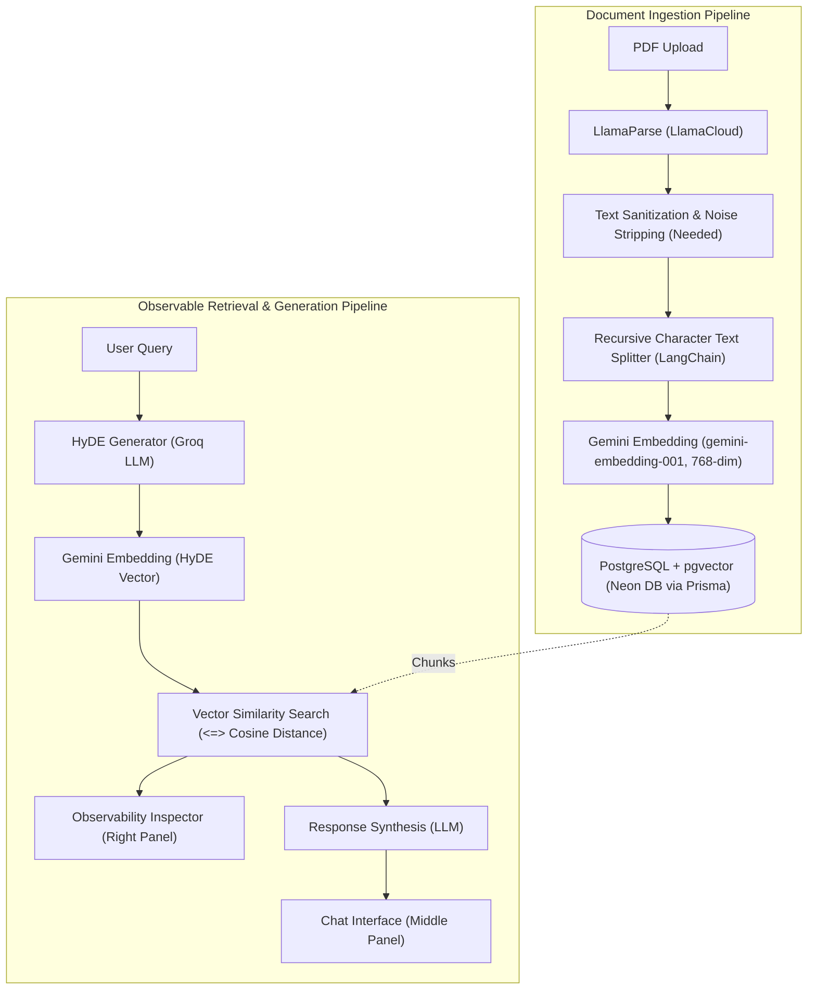

# Project Progress: Observable RAG

**Observable RAG** is an end-to-end Retrieval-Augmented Generation (RAG) platform built with Next.js, PostgreSQL (`pgvector`), LlamaParse, Google Gemini Embeddings, and Groq LLM inference. The core goal of this project is to provide full transparency into the RAG pipeline—exposing intermediate steps such as Hypothetical Document Embeddings (HyDE), vector similarity scores, chunk retrievals, and generation context in real time.

---

## 🏗️ Architecture Overview

---

## 📊 Feature & Milestone Status

### 1. Ingestion Pipeline
- [x] **PDF Document Upload**: Frontend file picker (`Upload.tsx`) with PDF validation and FormData transmission.
- [x] **Document Parsing**: Integrated LlamaCloud (LlamaParse) for markdown / full-text extraction (`api/upload/route.ts`).
- [x] **Text Chunking**: Configured LangChain `RecursiveCharacterTextSplitter` (`chunkSize: 1000`, `chunkOverlap: 200`).
- [x] **Vector Embeddings**: Integrated Google GenAI SDK (`gemini-embedding-001`) with 768-dimension output configuration (`api/embeddings.ts`).
- [x] **Vector Database Storage**: PostgreSQL with `pgvector` extension hosted on Neon, storing parent `Document` records and raw vector-cast `Chunk` rows (`::vector`).
- [ ] **Text Cleaning & Normalization**: Stripping markdown noise, excessive whitespace, and broken table/HTML tags.
- [ ] **Background Processing / Queue**: Processing large documents asynchronously without blocking HTTP requests.
- [ ] **Document Metadata Extraction**: Extracting page numbers, sections, and metadata per chunk.

---

### 2. Retrieval & Query Engine
- [x] **Query Request Validation**: Zod-based request validation (`api/query/route.ts`).
- [x] **HyDE (Hypothetical Document Embeddings)**: Generates hypothetical ideal answers using Groq SDK (`qwen/qwen3.6-27b` / `llama-3.3-70b-versatile`).
- [x] **Query Vector Embedding**: Embeds HyDE outputs into 768-dimensional vector representations using Gemini Embeddings.
- [x] **Vector Similarity Search**: Raw SQL cosine similarity queries (`embedding <=> ${embeddedHyDEval}`) returning top-K relevant chunks.
- [ ] **Context Assembly & Final Synthesis**: Prompt formatting that injects retrieved chunks into an LLM response synthesis call.
- [ ] **Hybrid Search (Dense + Sparse/BM25)**: Combining semantic vector search with keyword search.
- [ ] **Reranking**: Secondary reranking (e.g. cross-encoder / Cohere) to refine retrieval quality.

---

### 3. User Interface & Layout
- [x] **Modern 3-Panel Layout**: Responsive 3-column architecture (`page.tsx`):
  - **Left Panel (`LeftPanel.tsx`)**: Document management sidebar with `Upload` and `Documents` list.
  - **Middle Panel (`MiddlePannel.tsx`)**: Query input (`Search.tsx`) and conversational response view.
  - **Right Panel (`RightPannel.tsx`)**: Dedicated observability inspector for pipeline transparency.
- [x] **Document Listing (`Documents.tsx`)**: Server-side Prisma query displaying all indexed documents.
- [x] **Search Component (`Search.tsx`)**: Interactive query submission bar connecting to `/api/query`.
- [ ] **Observability Inspector UI**: Visualizing intermediate steps:
  - Generated HyDE text
  - Retrieved chunks with cosine similarity distances
  - Token consumption & stage-by-stage latency breakdowns
- [ ] **Interactive Chat & Streamed Responses**: Streaming answers into the middle panel with citations and chunk references.
- [ ] **Optimistic UI / Real-time Ingestion Updates**: Dynamic refresh of document list upon upload completion.

---

### 4. Backend & Codebase Refactoring
- [x] **Prisma Configuration & Custom Output**: Configured Prisma v7 with `@prisma/adapter-pg` driver adapter.
- [x] **Database Migrations**: Initialized pgvector extension and core schemas (`Document`, `Chunk`).
- [ ] **Layered Separation of Concerns**:
  - `src/validators/`: Request schemas and validation logic.
  - `src/services/`: Core business logic (ingestion service, search service, embedding service, LLM service).
  - `src/repository/`: Data access layer for Prisma and raw SQL vector queries.
- [ ] **Cleanup of Deprecated Routes**: Remove redundant `src/api/upload/route.ts` and legacy stubs.

---

## 🚨 Known Issues, Flaws & Areas for Improvement

### 1. Document Extraction & Text Quality Deficiencies
- **Dirty Text Extraction & Token Waste**:
  - LlamaParse `tier: "cost_effective"` output in `result.text_full` is split directly without pre-processing. It leaves behind repeated whitespace, blank lines, orphaned markdown table delimiters (`|---|`), HTML comments, raw headers/footers, and page break artifacts.
  - **Impact**: These noise tokens waste database vector storage, burn unnecessary embedding token limits, and dilute cosine similarity accuracy by shifting semantic vector representations away from actual content.
- **Naïve Chunking Strategy**:
  - The `RecursiveCharacterTextSplitter` uses arbitrary character limits (`chunkSize: 1000, chunkOverlap: 200`) without structural awareness. It splits sentences across chunks, severs tables mid-row, and breaks markdown code blocks.
  - **Remedy**: Implement a sanitization regex pipeline followed by Markdown-aware or semantic chunking (`MarkdownHeaderTextSplitter` + sentence-boundary preservation).
- **Synchronous Blocking Upload Pipeline**:
  - Parsing via LlamaCloud (10s–30s+), chunking, Gemini embedding calls, and DB inserts all run sequentially within a single HTTP POST request (`/api/upload`).
  - **Impact**: Medium-to-large PDFs easily hit serverless execution timeouts and browser request timeouts, causing upload crashes with no retry or resume capability.
- **Unbounded Sequential Database Insertions**:
  - Individual raw SQL insert queries are created inside a loop and executed concurrently with `Promise.all(insertPromises)`. For documents with 100+ chunks, this floods the PostgreSQL connection pool (Neon DB) instead of executing a single batch multi-row `INSERT INTO "Chunk" VALUES (...)`.
- **Missing Ingestion Metadata**:
  - `Chunk` records do not store page numbers, section headers, or token counts, making granular citation and attribution impossible.
- **No Transaction Management / Rollback**:
  - If embedding generation or chunk insertion fails halfway, the parent `Document` record remains in the database in an orphaned/zombie state with zero chunks.

---

### 2. Retrieval, Synthesis & RAG Pipeline Gaps
- **Missing Synthesis Step (Incomplete RAG Loop)**:
  - In `/api/query/route.ts`, the endpoint performs HyDE and vector retrieval, but **never passes the retrieved chunks to the LLM to generate an actual synthesized response**. It merely returns the raw HyDE completion (`NextResponse.json({ message: llmHyDE })`). The user gets a hallucinated hypothetical text instead of an answer grounded in the uploaded documents.
- **HyDE Semantic Drift & Hallucination Risk**:
  - For specialized, proprietary, or highly technical documents, HyDE hallucinates plausible-sounding terminology that may not match source document vocabulary, causing the vector search to retrieve irrelevant chunks.
- **Lack of Hybrid Search (Dense + Sparse)**:
  - Semantic vector search struggles with exact keyword queries (e.g. part numbers, error codes, person names, dates). There is no BM25 or Postgres full-text search integration to balance semantic recall with keyword precision.
- **No Relevance Distance Thresholding**:
  - The vector query statically fetches `LIMIT 5` chunks regardless of distance. If the best match has a low cosine similarity (e.g., $> 0.8$ distance), irrelevant noise chunks are still returned.
- **Missing Vector Index in Database Schema**:
  - `embedding Unsupported("vector(768)")` in `schema.prisma` lacks an HNSW or IVFFlat index definition (e.g., `CREATE INDEX ON "Chunk" USING hnsw (embedding vector_cosine_ops)`). Without an index, similarity searches trigger an $O(N)$ sequential table scan on every query.

---

### 3. Frontend, UI/UX & State Architecture Flaws
- **Disconnected State & Discarded Query Results**:
  - `Search.tsx` handles the POST request independently and immediately discards the result via `console.log(res)`. The query response is never shared with `MiddlePannel.tsx` or `RightPannel.tsx`.
- **Unimplemented / Placeholder UI Panels**:
  - `MiddlePannel.tsx` contains static Lorem Ipsum placeholder text and has no chat message thread or response streaming UI.
  - `RightPannel.tsx` is an empty placeholder (`
Right Section
`) with zero observability features implemented (no HyDE viewer, no chunk similarity inspection, no latency breakdown).
- **Hardcoded Localhost API Endpoint**:
  - `Search.tsx` makes requests to `http://localhost:3000/api/query` instead of relative `/api/query`, causing immediate failures in production or when running on non-default ports.
- **No Upload Loading Indicator or Progress Bar**:
  - `Upload.tsx` provides no loading spinner, progress indicator, or error notifications while LlamaParse processes the document (which takes 15–30 seconds), leading users to believe the app is frozen.
- **No Automatic Document List Revalidation**:
  - Uploading a new PDF does not trigger revalidation of `Documents.tsx`. Users are forced to manually refresh the page in their browser to see the newly indexed document.
- **Typos in Component Filenames & Raw Styling**:
  - `MiddlePannel.tsx` and `RightPannel.tsx` have spelling typos (`Pannel` vs `Panel`) and use crude hardcoded backgrounds (`bg-blue-900`, `bg-red-700`) rather than a cohesive design system.

---

### 4. API, Security & Code Quality Issues
- **Unbatched Gemini API Calls (`api/embeddings.ts`)**:
  - All chunks are passed in a single batch to `ai.models.embedContent`. Documents with >100 chunks will breach Gemini payload limits or trigger rate limit exceptions without retry mechanisms.
- **Missing Server-Side File Validation**:
  - `/api/upload` lacks server-side file size limits, MIME type verification, and PDF magic number checks.
- **Redundant / Deprecated Files**:
  - `src/api/upload/route.ts` remains as a legacy duplicate of `src/app/api/upload/route.ts`.
  - `src/app/api/upload/pushDB.ts` is entirely commented out dead code.
  - Empty directories (`src/services`, `src/repository`, `src/validators`) exist without implementation.

---

## 🛠️ Technology Stack Summary

| Layer | Technologies |
| :--- | :--- |
| **Frontend Framework** | Next.js 16 (App Router), React 19, TypeScript |
| **Styling** | TailwindCSS v4 |
| **Database & Vector Store** | PostgreSQL + `pgvector` (Neon DB) |
| **ORM & DB Client** | Prisma Client v7 (`@prisma/adapter-pg`, `@prisma/client`) |
| **Document Parsing** | `@llamaindex/llama-cloud` (LlamaParse) |
| **Text Processing** | `@langchain/textsplitters` (`RecursiveCharacterTextSplitter`) |
| **Embedding Model** | Google Gemini (`gemini-embedding-001`, 768-dim) via `@google/genai` |
| **LLM Inference** | Groq SDK (`groq-sdk`) using `qwen/qwen3.6-27b` / `llama-3.3-70b-versatile` |
| **Validation & Utilities** | Zod, Axios |

---

## 📋 Next Immediate Steps & Remediation Plan

1. **Text Sanitization & Chunk Cleaning**:
   - Implement a text normalization utility that cleans up markdown tags, extra spaces, line breaks, table debris, and page headers/footers before splitting.
2. **Complete RAG Synthesis in `/api/query`**:
   - Assemble top-5 retrieved chunks into a prompt and call Groq LLM to synthesize the final grounded answer with citations.
3. **Structured Observability Payload & UI**:
   - Return `{ hyde, chunks: [{ content, similarity, docName }], answer, timings }` from `/api/query`.
   - Build out `RightPannel.tsx` to visualize HyDE generation, cosine distance scores, and chunk inspector.
   - Build out `MiddlePannel.tsx` to render conversational history and streaming answers.
4. **Fix Frontend Connectivity & UX**:
   - Replace hardcoded `http://localhost:3000` with relative paths.
   - Add loading spinners/states to `Upload.tsx` and `Search.tsx`.
   - Add automatic revalidation on document upload.
5. **Database Indexing & Performance**:
   - Add HNSW index to `Chunk.embedding` in PostgreSQL.
   - Replace sequential chunk inserts with single multi-row SQL batch inserts.
6. **Backend Modularization**:
   - Refactor logic into `services/`, `repository/`, and `validators/`.
   - Clean up orphaned routes and dead code.
